<div align="center">

# 🚗 AHD Automobiles · Tableau de bord Power BI de vente automobile

**Le pilotage complet d'une concession de voitures de prestige, de la base SQL Server à la décision, en 7 pages.**


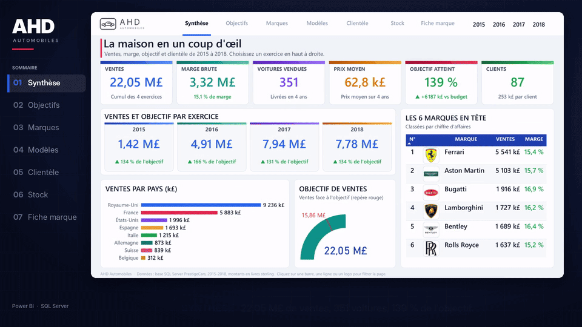

📄 [**Le rapport complet en PDF**](docs/AHD_Automobiles.pdf) &nbsp;·&nbsp; 🎬 [**La vidéo de présentation (1 min 20)**](docs/video/AHD_Automobiles_LinkedIn.mp4) &nbsp;·&nbsp; 🧬 [**Le modèle sémantique**](#-architecture)

</div>

---

## 📚 Sommaire

1. [📊 Aperçu du tableau de bord](#-aperçu-du-tableau-de-bord)
2. [🏆 Résultats clés](#-résultats-clés)
3. [💼 Impact métier](#-impact-métier)
4. [🧭 Synthèse exécutive](#-synthèse-exécutive)
5. [🔄 Pipeline](#-pipeline)
6. [🧬 Lignage](#-lignage)
7. [🏗️ Architecture](#-architecture)
8. [🧰 Stack technique](#-stack-technique)
9. [✅ Conclusion](#-conclusion)
10. [💡 Mot de la fin](#-mot-de-la-fin)

---

## 📊 Aperçu du tableau de bord

Sept pages, une seule histoire : celle de chaque voiture vendue, de son achat jusqu'à sa vente. Chaque page répond à une question précise d'un vendeur, d'un directeur de concession ou d'un contrôleur de gestion.

<div align="center">
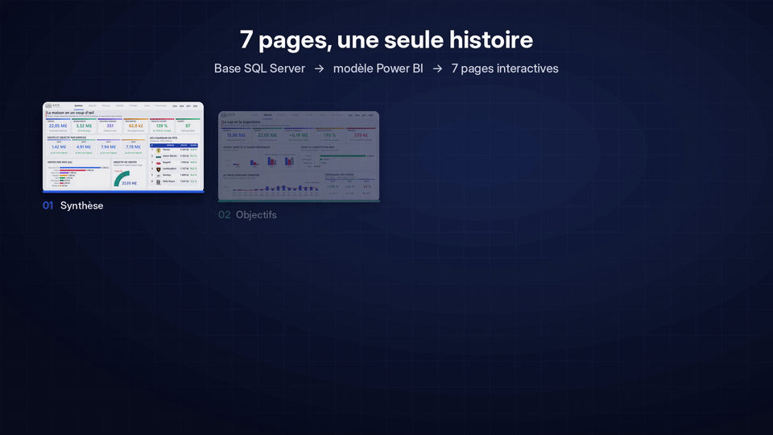
</div>

| # | Page | La question à laquelle elle répond | Ce qu'on y voit |
|:-:|---|---|---|
| 01 | **Synthèse** | Où en est la concession, en un coup d'œil ? | 6 indicateurs clés, ventes et objectif par exercice, ventes par pays, jauge de l'objectif, les 6 marques en tête avec leur logo |
| 02 | **Objectifs** | Tient-on le cap ? | Objectif, réalisé, écart, taux d'atteinte, comparaison avec l'année précédente, écart par pays, trajectoire par trimestre, croissance par exercice |
| 03 | **Marques** | Quelles marques font la maison ? | Palmarès des 12 marques avec logos, classement au choix par ventes, marge brute ou voitures vendues, univers de marque, pays des constructeurs |
| 04 | **Modèles** | Quels modèles, à quel prix, dans quelles couleurs ? | Les 8 modèles phares, les gammes de prix, les teintes qui se vendent |
| 05 | **Clientèle** | Qui achète, où, et avec quel profil ? | Meilleurs clients, ventes par pays, capacité de dépense, revendeurs ou particuliers, clients à risque |
| 06 | **Stock** | Combien coûte une voiture avant d'être vendue, et que reste-t-il à écouler ? | Cascade du coût d'achat au chiffre d'affaires, stock à écouler par marque, délai de vente par gamme de prix |
| 07 | **Fiche marque** | Que vaut une marque, prise seule ? | Plaque d'identité avec logo, origine et positionnement, puis ventes, rang, marge, stock, modèles phares et pays acheteurs, recalculés pour la marque choisie |

<details open>
<summary><b>🖼️ Les 7 pages en grand</b></summary>

### 01 · Synthèse
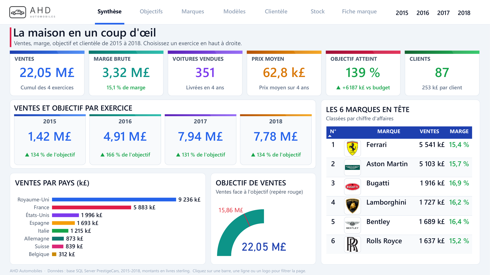

### 02 · Objectifs
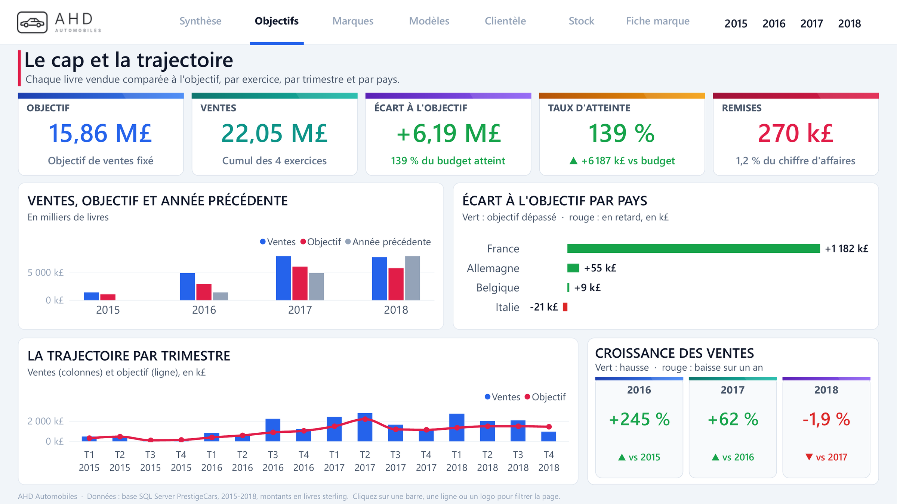

### 03 · Marques
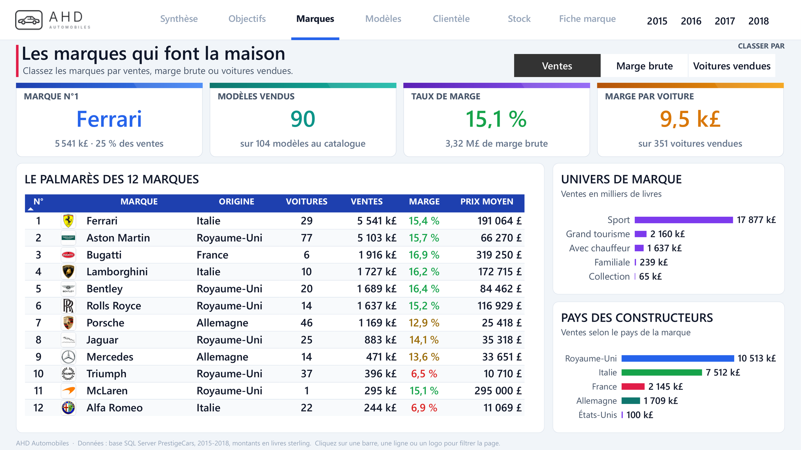

### 04 · Modèles
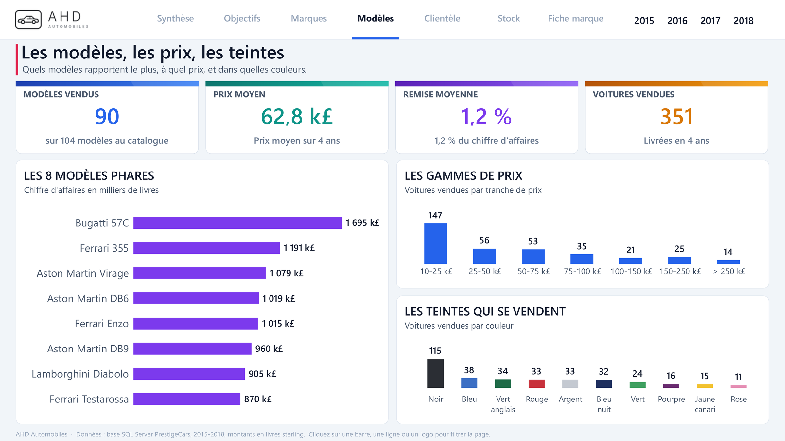

### 05 · Clientèle
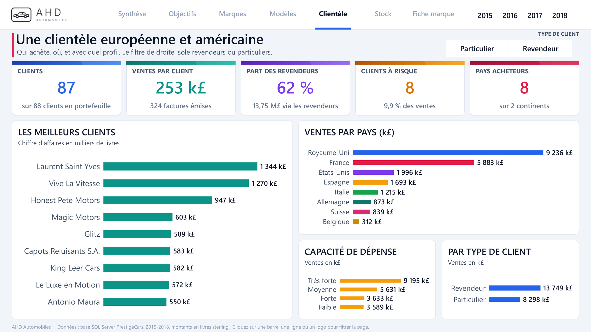

### 06 · Stock
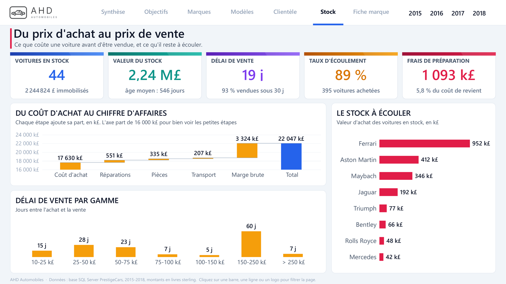

### 07 · Fiche marque
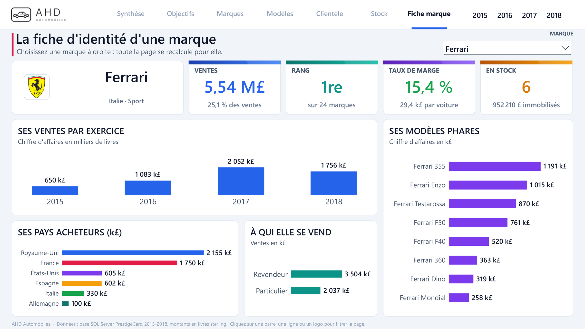

</details>

<table>
<tr>
<td width="50%">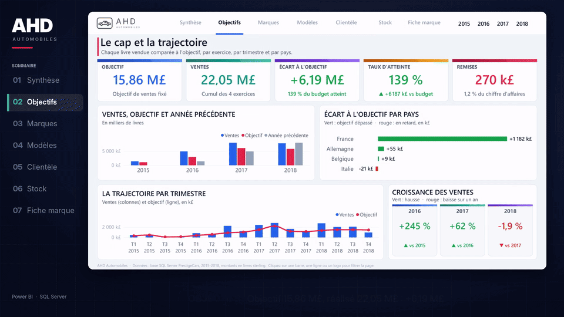<p align="center"><b>Objectifs</b> · vert quand ça monte, rouge quand ça baisse</p></td>
<td width="50%">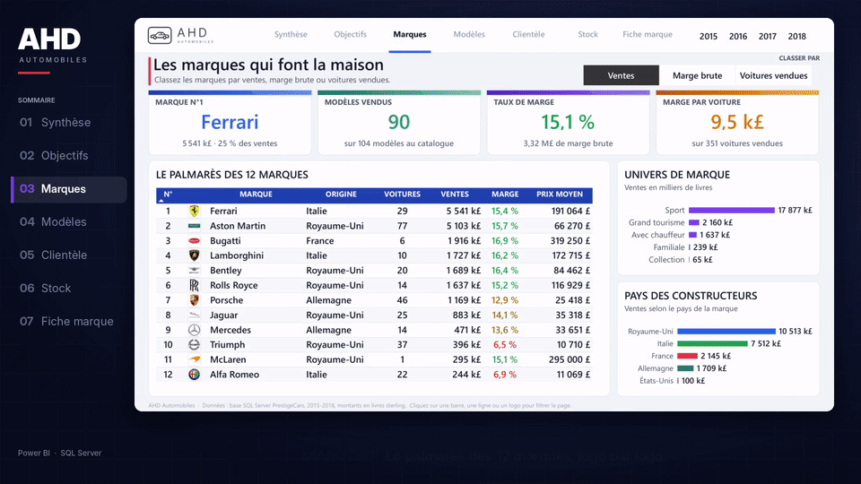<p align="center"><b>Marques</b> · le palmarès des 12 marques, logo par logo</p></td>
</tr>
<tr>
<td width="50%">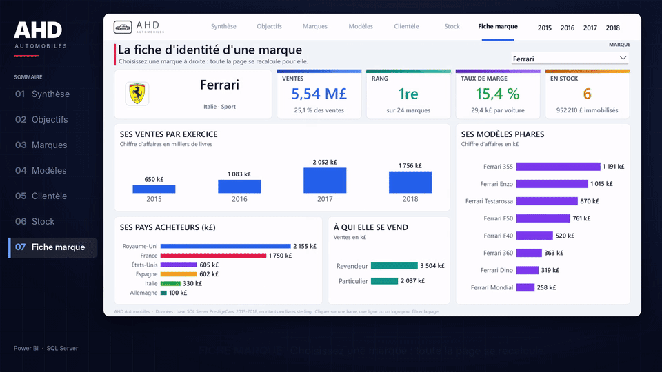<p align="center"><b>Fiche marque</b> · toute la page se recalcule pour la marque choisie</p></td>
<td width="50%"><p align="center"><b>Auteur</b> · Abdoul Hamid Diallo</p></td>
</tr>
</table>

---

## 🏆 Résultats clés

Les chiffres ci-dessous sont ceux que le tableau de bord met en avant sur l'ensemble de la période 2015 à 2018.

| Indicateur | Valeur | Lecture |
|---|---:|---|
| 💷 Chiffre d'affaires | **22,05 M£** | cumul des 4 exercices |
| 📈 Marge brute | **3,32 M£** | soit **15,1 %** du chiffre d'affaires |
| 🚘 Voitures vendues | **351** | sur 395 voitures achetées, soit un taux d'écoulement de **89 %** |
| 🏷️ Prix moyen | **62,8 k£** | par voiture vendue |
| 🎯 Objectif | **15,86 M£** | atteint à **139 %**, soit **+6,19 M£** au-dessus du budget |
| 📅 Croissance | **+245 %** puis **+62 %** puis **-1,9 %** | 2016, 2017, 2018 : la première baisse apparaît en 2018 |
| 🏁 Marque n°1 | **Ferrari** | **5,54 M£**, soit **25 %** des ventes, avec **15,4 %** de marge |
| 👥 Clients | **87** | dans **8 pays**, **253 k£** par client, **62 %** des ventes via les revendeurs |
| 📦 Stock | **44 voitures** | **2,24 M£** immobilisés |
| ⏱️ Délai de vente | **19 jours** | **93 %** des voitures vendues en moins de 30 jours |
| 🧾 Remises | **270 k£** | **1,2 %** du chiffre d'affaires |

---

## 💼 Impact métier

| Pour qui | Ce que le tableau de bord change |
|---|---|
| **Direction de la concession** | La santé de l'activité se lit en 5 secondes sur la Synthèse : ventes, marge, objectif, clients. Le vert et le rouge disent tout de suite si un chiffre monte ou baisse. |
| **Équipe commerciale** | Le palmarès des marques, les modèles phares et les meilleurs clients montrent où concentrer l'effort de vente. |
| **Achats et stock** | La cascade du coût d'achat au prix de vente rend visibles les réparations, les pièces et le transport. Le stock à écouler et le délai de vente par gamme guident les prochains achats. |
| **Contrôle de gestion** | L'écart à l'objectif par pays, la trajectoire par trimestre et la comparaison avec l'année précédente servent de base aux revues mensuelles. |
| **Marketing** | Les teintes qui se vendent, les gammes de prix et le profil des clients (revendeurs, particuliers, capacité de dépense) orientent les campagnes. |

---

## 🧭 Synthèse exécutive

- **Le problème** : une base SQL Server riche (ventes, stock, modèles, marques, clients, objectifs) mais aucune vue d'ensemble pour piloter la concession.
- **La solution** : un modèle sémantique en étoile de 13 tables et 207 mesures DAX, et un rapport de 7 pages pensé comme un parcours, du global (Synthèse) au détail (Fiche marque).
- **Ce qui fait la différence** :
  - 🟢🔴 **Vert et rouge selon le sens** : chaque phrase sous un chiffre est verte quand il progresse, rouge quand il recule.
  - 🏷️ **24 logos de marques**, bien cadrés, dans les tableaux et sur la fiche de chaque marque.
  - 🖱️ **Interactif** : un clic sur une barre, une ligne ou un logo filtre toute la page, et les exercices se choisissent en haut à droite.
  - 🔁 **Classement au choix** : la page Marques se reclasse par ventes, marge brute ou voitures vendues.
  - 🪪 **Une fiche par marque** : toute la page se recalcule pour la marque choisie.
- **Le format** : projet **PBIP** (modèle en **TMDL**, rapport en **PBIR**), lisible et versionnable dans Git, page par page et mesure par mesure.

---

## 🔄 Pipeline

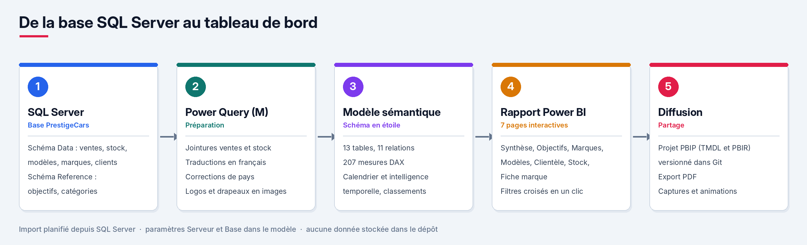

| Étape | Outil | Ce qui est fait |
|:-:|---|---|
| 1 | **SQL Server** | Lecture de la base `PrestigeCars` : schéma `Data` (Sales, SalesDetails, Stock, Model, Make, Customer, Country) et schéma `Reference` (Budget, MarketingCategories, MarketingInformation). |
| 2 | **Power Query (M)** | Jointure des ventes et du stock, calcul du coût total, de la marge et des jours en stock, gammes de prix, traduction des couleurs et des catégories en français, correction de l'origine de certaines marques, rattachement des modèles hors catalogue, logos et drapeaux convertis en images. |
| 3 | **Modèle sémantique** | Schéma en étoile, calendrier généré, relations à sens unique, 207 mesures DAX rangées en 8 dossiers. |
| 4 | **Rapport Power BI** | 7 pages, thème sur mesure, couleurs dynamiques pilotées par des mesures, interactions croisées. |
| 5 | **Diffusion** | Export PDF, vidéo de présentation, projet PBIP versionné. |

Le serveur et la base sont deux **paramètres** du modèle (`Serveur`, `Base`) : il suffit de les changer pour pointer vers une autre instance.

---

## 🧬 Lignage

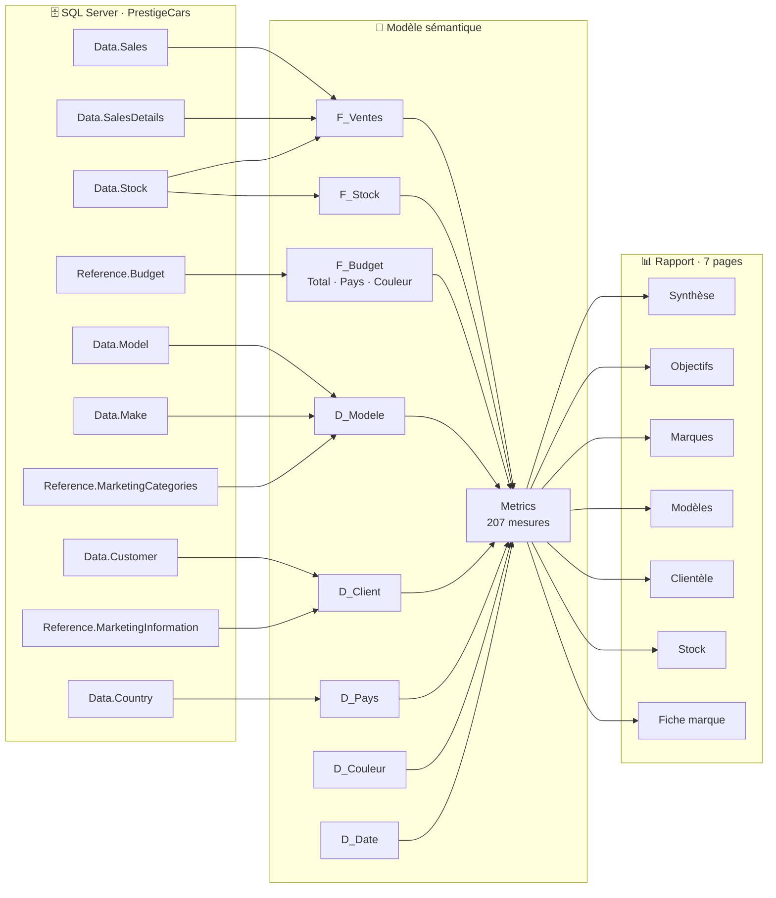

---

## 🏗️ Architecture

### 🧠 Le modèle sémantique

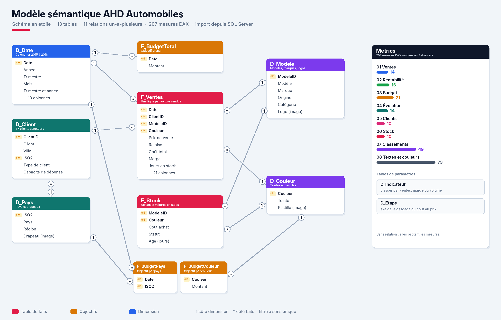

| Table | Rôle | Colonnes | Contenu |
|---|---|:-:|---|
| `F_Ventes` | Faits | 21 | une ligne par voiture vendue : prix, remise, coûts, marge, jours en stock, gamme de prix |
| `F_Stock` | Faits | 8 | chaque voiture achetée, vendue ou encore en stock, avec son âge |
| `F_BudgetTotal` | Objectifs | 2 | objectif global par mois |
| `F_BudgetPays` | Objectifs | 3 | objectif par pays et par mois |
| `F_BudgetCouleur` | Objectifs | 3 | objectif par couleur et par année |
| `D_Date` | Dimension | 10 | calendrier 2015 à 2018 (année, trimestre, mois et leurs ordres de tri) |
| `D_Modele` | Dimension | 8 | modèle, marque, origine, catégorie, positionnement, **logo de la marque** |
| `D_Client` | Dimension | 8 | client, ville, pays, type (revendeur ou particulier), risque de crédit, capacité de dépense |
| `D_Pays` | Dimension | 5 | pays, région, **drapeau** |
| `D_Couleur` | Dimension | 4 | couleur, teinte, ordre, **pastille de couleur** |
| `D_Indicateur` | Paramètre | 2 | choix du classement : ventes, marge brute ou voitures vendues |
| `D_Etape` | Paramètre | 2 | axe de la cascade du coût d'achat au chiffre d'affaires |
| `Metrics` | Mesures | 1 | les 207 mesures DAX |

**Bonnes pratiques appliquées**

- ⭐ **Schéma en étoile** : faits au centre, dimensions autour, 11 relations un-à-plusieurs à sens unique.
- 🗂️ **Une table dédiée aux mesures** (`Metrics`), rangée en 8 dossiers d'affichage.
- 📅 **Calendrier marqué comme table de dates**, pour l'intelligence temporelle (`SAMEPERIODLASTYEAR`).
- 🖼️ **Images dans le modèle** : logos, drapeaux et pastilles stockés en colonnes de type URL d'image, sans dépendance à un site externe.
- 🌍 **Culture `fr-FR`** : nombres, pourcentages et livres sterling au format français.
- 🧩 **Paramètres de connexion** : le serveur et la base se changent sans toucher aux requêtes.

### 🧮 Les 207 mesures DAX

| Dossier | Mesures | Exemples |
|---|:-:|---|
| 01 Ventes | 14 | Ventes, Voitures vendues, Prix moyen, Remises |
| 02 Rentabilité | 16 | Coût de revient, Marge brute, Taux de marge, Marge par voiture |
| 03 Budget | 21 | Budget, Écart budget, Atteinte budget, objectif par pays, tuiles par exercice |
| 04 Évolution | 14 | Ventes N-1, Croissance des ventes, de la marge, des voitures et du prix moyen |
| 05 Clients | 10 | Clients en portefeuille, Ventes par client, part des revendeurs, clients à risque |
| 06 Stock | 10 | Valeur du stock, Délai de vente, Taux d'écoulement |
| 07 Classements | 49 | Indicateur au choix, Rang marque, Rang modèle, Rang client, palmarès des 12 marques |
| 08 Textes et couleurs | 73 | sous-titres dynamiques, couleurs vertes et rouges selon le sens |

<details>
<summary><b>🔍 Quelques mesures clés</b></summary>

**Les fondations**

```dax
Ventes = SUM ( F_Ventes[Prix de vente] )

Marge brute = [Ventes] - [Coût de revient]

Taux de marge = DIVIDE ( [Marge brute], [Ventes] )
```

**Un objectif qui s'adapte au filtre** : l'objectif par pays quand un pays est choisi, l'objectif global sinon.

```dax
Budget = IF ( ISCROSSFILTERED ( D_Pays ), [Budget pays], [Budget total] )

Atteinte budget = DIVIDE ( [Ventes], [Budget] )
```

**L'intelligence temporelle**

```dax
Ventes N-1 = CALCULATE ( [Ventes], SAMEPERIODLASTYEAR ( D_Date[Date] ) )

Croissance ventes =
IF ( NOT ISBLANK ( [Ventes N-1] ), DIVIDE ( [Ventes] - [Ventes N-1], [Ventes N-1] ) )
```

**Un classement au choix de l'utilisateur**, avec un format qui change selon l'indicateur choisi :

```dax
Indicateur =
VAR s = SELECTEDVALUE ( D_Indicateur[Indicateur], "Ventes" )
RETURN SWITCH ( s, "Marge brute", [Marge brute] / 1000, "Voitures vendues", [Voitures vendues], [Ventes] / 1000 )

Rang marque =
IF (
    ISINSCOPE ( D_Modele[Marque] ),
    CALCULATE (
        RANKX ( ALLSELECTED ( D_Modele[Marque] ), [Indicateur], , DESC, DENSE ),
        REMOVEFILTERS ( D_Modele[Logo], D_Modele[Origine], D_Modele[Catégorie], D_Modele[Positionnement] )
    )
)
```

**Le vert et le rouge pilotés par une mesure**, appliqués en mise en forme conditionnelle :

```dax
T couleur croissance = IF ( [Croissance ventes] >= 0, "#16A34A", "#DC2626" )

Cr2018 Affiche =
VAR v = CALCULATE ( [Croissance ventes], D_Date[Année] = 2018 )
RETURN IF ( ISBLANK ( v ), BLANK (), IF ( v >= 0, "+" & FORMAT ( v, "0 %" ), FORMAT ( v, "0.0 %" ) ) )
```

</details>

### 🎨 Le système visuel

| Élément | Choix |
|---|---|
| **Fond** | gris très clair, cartes blanches à coins arrondis, en-tête blanc avec le logo AHD et la navigation |
| **Couleurs** | bleu, sarcelle, violet, ambre, rouge et vert, une par carte d'indicateur |
| **Sens des chiffres** | vert `#16A34A` quand ça progresse, rouge `#DC2626` quand ça recule, ambre pour une marge moyenne |
| **Lisibilité** | titres en 18, chiffres clés en 34 à 40, noms de catégories en 14 à 16, aucune réduction automatique des textes |
| **Pays** | une couleur fixe par pays, la même sur toutes les pages |
| **Navigation** | menu des 7 pages et choix de l'exercice (2015 à 2018) en haut de chaque page |

### 📁 Structure du dépôt

```text
ahd-automobiles-powerbi/
├── README.md
├── docs/
│   ├── AHD_Automobiles.pdf              # le rapport complet, 7 pages
│   ├── gifs/                            # animations tirées de la vidéo
│   ├── images/                          # captures des pages et diagrammes
│   └── video/AHD_Automobiles_LinkedIn.mp4
└── powerbi/
    ├── AHD Automobiles.pbip             # le fichier à ouvrir dans Power BI Desktop
    ├── AHD Automobiles.Report.zip       # le rapport au format PBIR (7 pages, 400 visuels, thème), à décompresser
    └── AHD Automobiles.SemanticModel/   # le modèle au format TMDL, lisible directement sur GitHub
```

---

## 🧰 Stack technique

| Outil | Usage |
|---|---|
|  | source des données, base `PrestigeCars` |
| -0F766E) | préparation, jointures, traductions, images |
|  | modèle sémantique et rapport |
|  | 207 mesures : calculs, classements, couleurs, textes |
|  | format projet lisible et versionnable dans Git |

### 🚀 Ouvrir le projet

1. Installez **Power BI Desktop** (version récente, avec le format PBIP activé).
2. Restaurez une base **`PrestigeCars`** sur votre instance **SQL Server**.
3. Décompressez `powerbi/AHD Automobiles.Report.zip` dans le dossier `powerbi`, à côté du fichier `.pbip`, puis ouvrez `powerbi/AHD Automobiles.pbip`.
4. Dans **Transformer les données**, réglez les paramètres **`Serveur`** (par défaut `localhost`) et **`Base`** (par défaut `PrestigeCars`).
5. Cliquez sur **Actualiser** : les 7 pages se remplissent.

### 🔒 À propos des données

Ce dépôt **ne contient aucune donnée**. Le projet PBIP ne stocke que la structure : requêtes, tables, relations, mesures et pages. Les données restent dans la base SQL Server et sont lues à l'actualisation. Le fichier de cache local de Power BI est exclu par le `.gitignore`.

---

## ✅ Conclusion

AHD Automobiles montre comment transformer une base relationnelle en un outil de pilotage complet pour une concession :

- 🗄️ **une source** : SQL Server, lue proprement par Power Query ;
- 🧠 **un modèle** : 13 tables en étoile, 11 relations, 207 mesures organisées ;
- 📊 **un parcours** : 7 pages, du coup d'œil global à la fiche de chaque marque ;
- 🎯 **une lecture immédiate** : grands chiffres, vert et rouge selon le sens, logos des marques ;
- 🔁 **un projet durable** : format PBIP versionné, paramètres de connexion, aucune donnée exposée.

---

## 💡 Mot de la fin

> Un bon tableau de bord ne montre pas tout. Il montre d'abord ce qui compte, dit tout de suite si c'est une bonne ou une mauvaise nouvelle, et laisse ensuite chacun creuser jusqu'au détail qui l'intéresse.

---

<div align="center">

### 👤 Auteur

**Abdoul Hamid Diallo** · Microsoft Fabric Data Engineer

Microsoft Fabric · Power BI · SQL Server · Azure · IA

`DP-600` `DP-700` `PL-300` `AI-102` `DP-100` `AI-900` `DP-900`

[](https://www.linkedin.com/in/abdoul-hamid-diallo-fabric-data-engineer/)
[](https://github.com/abdoulhamiddiallo)

</div>
